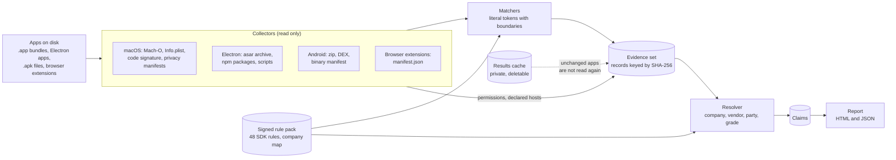
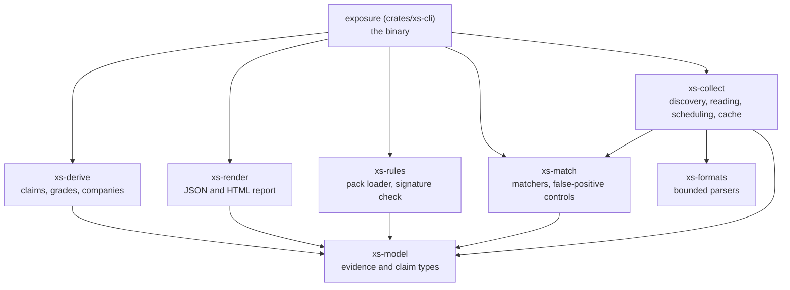
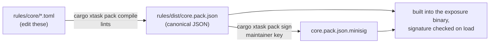

# exposure-scanner

**A local scanner that shows which companies have a channel to your data,
through which apps, with the evidence for every finding.**

[](https://github.com/Adityaakr/exposure-scanner/actions/workflows/ci.yml)
[](LICENSE)

> [!IMPORTANT]
> **This project is under active development.** Milestone 1 is not finished,
> there is no release yet, and commands, the report format and its output may
> change between commits. Suggestions, bug reports and contributions are
> welcome: open an [issue](https://github.com/Adityaakr/exposure-scanner/issues)
> or read [CONTRIBUTING.md](CONTRIBUTING.md) to get started.

## Contents

- [What it is](#what-it-is)
- [What it finds](#what-it-finds)
- [How it works](#how-it-works)
- [Quick start](#quick-start)
- [Usage](#usage)
- [Reading the report](#reading-the-report)
- [Privacy guarantees](#privacy-guarantees)
- [What a device-side scan cannot see](#what-a-device-side-scan-cannot-see)
- [Platforms and roadmap](#platforms-and-roadmap)
- [Architecture](#architecture)
- [Rule packs](#rule-packs)
- [Testing and the six properties](#testing-and-the-six-properties)
- [Licences and data sources](#licences-and-data-sources)
- [Contributing](#contributing)
- [Acknowledgements](#acknowledgements)

## What it is

Apps ship code from analytics, advertising, attribution and session-replay
companies. Each of those SDKs is a channel from the app to a company you may
never have heard of, and nothing on your computer lists them.

`exposure` is a command-line tool that reads the apps already on your disk,
recognises third-party SDKs by literal markers they cannot avoid leaving,
maps each one to the company that owns it, and writes a report in which every
statement links to a record you can check by hand.

- **Evidence, not guesses.** Each finding carries a grade that says how
  strong its evidence is, and cites the raw records it rests on: the marker,
  the file, the table, how often.
- **Local and inert.** A scan reads files. It executes nothing, changes no
  app, and contains no network code at all. All it writes is the report and a
  private cache, so that the next scan reads only the apps that changed.
- **Reproducible.** The same apps and the same rule pack give the same
  report, byte for byte, on any machine and with any number of threads.

## What it finds

| Finding | Example | Where it comes from |
|---|---|---|
| **SDKs and the companies behind them**, per app | PostHog (analytics), in Logseq, owned by PostHog | Framework folders, linked libraries, Objective-C class names and binary literals on macOS; npm packages and bundled script literals in Electron apps; manifest entries, DEX classes and strings in Android packages |
| **Hosts an app declares** | An update feed on `ranchero.com`, first party to NetNewsWire | `SUFeedURL` in `Info.plist`; tracking domains in privacy manifests |
| **What each app may access** | Camera, microphone, location, contacts, files, other apps | Usage descriptions and entitlements on macOS; `uses-permission` on Android |
| **Browser extensions with powerful permissions** | May read and change data on every website you visit; may read your browsing history | `manifest.json` of every extension in your Chrome, Edge, Brave, Arc, Dia, Vivaldi, Chromium and Firefox profiles |

The built-in rule pack recognises 48 SDKs across analytics, advertising,
attribution, profiling, session replay, crash reporting and customer
messaging ([full list](docs/scanning.md#the-built-in-rule-pack)).

A scan of two of the repository's test fixtures, a synthetic Electron app and
a synthetic Android package:

```console
$ exposure scan tests/fixtures/macos/ElectronSkeleton.app tests/fixtures/android/Skeleton.apk --json report.json
exposure: scanned 2 apps (6 files, 6777 bytes): 4 claims, 0 coverage notes
exposure: headline: 0 companies at contacts or above, 1 company at contains, 2 apps with a third-party channel
exposure: scope: the paths given and nothing else; the installed-app folders were not searched
exposure: cache: 0 apps unchanged since an earlier scan and not read again, 2 apps read
```

Each of the four claims in `report.json` reads like this one, and each id
under `evidence` is a record in the same file:

```json
{
  "type": "channel",
  "subject": {"kind": "app", "platform": "android", "id": "org.example.exposure.skeleton", "version": "1.0.0"},
  "object": {"kind": "sdk", "id": "sdk/posthog", "name": "PostHog"},
  "company": "posthog", "category": "analytics", "headline": true, "party": "third",
  "grade": "contains", "confidence": "high", "witnesses": 2,
  "evidence": ["sha256:1792…3db6", "sha256:631f…5b91"]
}
```

PostHog is analytics, so it counts in the headline. Sentry, found in both
apps too, is crash reporting: it is in the report and not in the counts.

## How it works



1. **Collect.** Collectors find the apps, read every file once in bounded
   windows, hash it, and parse the parts that name code: binary headers,
   class tables, manifests, archives. Each parser takes a byte slice and stops
   at fixed budgets. An app that has not changed since the last scan is not
   read again: its records come from a private results cache.
2. **Match.** Matchers compiled from the rule pack look for literal tokens,
   each with a boundary rule, and record every hit as an evidence record.
   Controls such as scope labels, a breadth guard and distinct-token minimums
   keep coincidental hits out.
3. **Resolve.** Pure functions turn evidence into claims: which company
   operates the SDK, who publishes the app, whether the channel is first or
   third party, and the highest grade the evidence supports.
4. **Report.** The claims and every record they cite are written as an HTML
   page grouped by company, a JSON document, or both. The page holds no
   script and loads nothing, so it stays inert whatever an app's names
   contain.

Everything before the evidence set touches the file system; everything after
it is a pure function. That split is enforced by the crate layout (see
[Architecture](#architecture)).

## Quick start

Build from source. You need the Rust toolchain pinned in
[`rust-toolchain.toml`](rust-toolchain.toml); `rustup` installs it on first
use.

```console
$ git clone https://github.com/Adityaakr/exposure-scanner.git
$ cd exposure-scanner
$ cargo build --release --package exposure
$ target/release/exposure scan --html report.html --json report.json
$ open report.html
```

On macOS, `exposure scan` without a path scans the apps in `/Applications`
and `~/Applications`, and the extensions in your browser profiles. A
[sample HTML report](tests/fixtures/report/Fixtures.report.html) built from
the repository's test fixtures is committed. To install the binary instead:

```console
$ cargo install --git https://github.com/Adityaakr/exposure-scanner --locked exposure
```

There are no prebuilt binaries: the first release is source only.

## Usage

```
exposure scan [PATH...] [--html FILE] [--json FILE] [--threads N] [--no-cache]
                                                    scan apps, extensions, or folders of them
exposure report FILE [--html FILE] [--json FILE]    derive the report again from saved evidence
exposure rules show                                 list the built-in rule pack
exposure rules verify PACK --sig SIGNATURE          check a signed pack file offline
exposure --help | --version
```

| Option | Effect |
|---|---|
| `PATH` | A macOS `.app` bundle, an Android `.apk` file, a browser extension (a Firefox `.xpi` file, or a Chromium `<id>/<version>` folder), or a folder, searched for all of them (never inside a bundle). When any `PATH` is given, only the `PATH`s are scanned. |
| `--html FILE` | Write the report for reading: one self-contained page, grouped by company. |
| `--json FILE` | Write the report a program reads. With neither `--html` nor `--json`, the JSON report goes to standard output. Report files are created readable by their owner only, because the list of apps a person uses is sensitive in itself. |
| `--threads N` | Worker threads. Default: one per core. The report does not depend on it. |
| `--no-cache` | Read every app again, and neither use nor keep the results cache. |

The summary on standard error ends with a scope line that says where the scan
looked. Apple's own apps in `/System/Applications` are not scanned unless you
name that folder.

**Browser extensions.** Only each extension's `manifest.json` (and, when its
name refers to one, its message catalogue) is read: never your history,
cookies, bookmarks, saved logins or pages. Each powerful permission becomes
an access claim such as "may read and change data on every website you
visit", which names no company and is not counted in the headline.

**The results cache.** A scan keeps what it found in each app, one file per
app, readable by its owner only, in `~/Library/Caches/exposure` on macOS (or
`$XDG_CACHE_HOME/exposure`, else `~/.cache/exposure`). An app whose files
look exactly as they did, scanned by the same build with the same rule pack,
is not read again: a scan of 16 installed apps drops from 1.4 s to 0.10 s.
The report is the same with the cache and without it, byte for byte. The
folder can be deleted at any time, and a scan run as root does not use it.

A path that does not exist is refused before anything is read. After that, an
app that cannot be read never stops the scan: it is reported as a coverage
note (`skipped`, `unreadable`, `over_budget`, ...), never as "nothing found".

Details: [What a scan reads](docs/scanning.md).

## Reading the report

Every finding is a **claim** with a **grade**. A claim takes the highest grade
its evidence supports, and new evidence can raise a grade but never lower it.

| Grade | In words | Means | Status |
|---|---|---|---|
| `declares` | declares | The app's own files name the endpoint, such as an update feed or a tracking domain in a privacy manifest | Reported now |
| `contains` | ships | The app ships the SDK's code: a class, package, framework or endpoint literal | Reported now |
| `contacts` | contacted | The OS or a capture recorded a connection | Milestone 2 |
| `confirmed` | confirmed | The receiver lists the sender, or a payload was inspected | Milestone 4 |

What an app may access has its own ladder: `requested` (the app asks for it;
reported now), `granted` and `used` (later milestones). The two ladders are
never joined: "ships an analytics SDK" and "may access the camera" never
become "sends pictures to an analytics company".

> [!NOTE]
> `contains` proves presence, not use. An app can ship code it never calls,
> or code of a service that has been retired. Only `contacts` shows a live
> flow.

**The headline is three counts, and there is no score:** companies at
`contacts` or above, companies at `contains`, and apps with at least one
third-party channel.

| Counted | Not counted |
|---|---|
| Claims that name a company, in five categories: advertising, analytics, attribution, profiling, session replay | Crash reporting, push delivery, payments and billing, customer messaging, update feeds, declared tracking domains no rule names, components (libraries with no company, such as updaters), unmapped hosts, and every access claim |

Each claim says whether it counts in its `headline` field, so the numbers can
be recounted from the claims. A host under no domain the rule pack lists is
**unmapped**: it is shown as itself, nobody is named as its owner, and it is
counted nowhere.

Details: [Reading the report](docs/report.md), including how the company, the
app's vendor and first or third party are decided.

## Privacy guarantees

A tool that reads the list of apps you use has to be safer than the apps it
reports on. These are enforced by mechanism and checked in CI, not left to
discipline.

| Guarantee | How it is enforced |
|---|---|
| **Local only.** Nothing leaves the machine. | There is no network code. `cargo deny` bans every crate that can open a socket; CI checks that the binary imports no socket function and runs a scan in a network namespace with no interfaces, under `strace`, and under a macOS sandbox that denies the network. |
| **Read only.** A scan changes no app and executes nothing. | Collectors only open files for reading. Symbolic links inside an app are never followed. Nothing is extracted to disk. Of a browser profile, only the extensions are opened: their manifests, and Firefox add-on archives. |
| **Deterministic.** Same evidence, rule pack and scope, same bytes. | Derivation and rendering live in `no_std` crates that cannot read a clock, a file or the environment. Records hold paths inside an app, never paths of your machine. The HTML report holds no date, no device name and no path you gave. |
| **Minimal storage.** | Only two things are written: the report you ask for, and the results cache. Both are readable by their owner only. The cache holds the same records the report shows, no paths and no file lists; it can be deleted at any time and is off with `--no-cache`. |
| **Rules are data.** | A rule is a literal and a boundary from a fixed list: no regular expressions, no scripts. The scanner only loads a pack whose signature verifies against a key built into the binary. |

## What a device-side scan cannot see

A report is only as complete as what a device can show. It cannot see:

- **What happens on servers.** What a company forwards to others from its own
  servers never touches the device.
- **What is inside encrypted traffic.** TLS hides the payload; the current
  build observes no traffic at all.
- **First-party proxying.** An app that sends data to a tracker through its
  own domain looks like a first-party host.
- **SDKs without a rule.** Only what the rule pack has a rule for is
  recognised. A clean report does not mean an app is clean.
- **Use.** Shipping code is not running it.
- **What you granted.** Which permissions you allowed in System Settings
  lives in the system's permission store, outside the app's files.

## Platforms and roadmap

| Platform | Status |
|---|---|
| macOS on Apple silicon | First supported platform. Installed apps are found automatically. Tested in CI on merges and nightly. |
| Linux | The CI platform for the portable core: every check runs there on every change. Scans the paths you name. |
| Android packages (`.apk`) | Scanned by path on any OS. |
| Browser extensions | Chromium-family browsers and Firefox: found automatically in your profiles on macOS, scanned by path elsewhere. |
| Phones, iOS exports, browser history | Milestone 2. |
| Windows | Not planned yet. |

| Milestone | Ships | Status |
|---|---|---|
| **1. Static truth** | Rust core, evidence format, rule pack, collectors for macOS bundles, Electron apps and Android packages, resolver, HTML report | **In progress** |
| 2. Phone and browser | iOS report import, Android phones over adb, browser join, browser extension audit, OS permission stores | Started: the browser extension audit is done |
| 3. Fix and diff | Fix recipes with an undo log, snapshots, a diff between scans | Planned |
| 4. Confirmed | Platform data-archive adapters, lab capture | Planned |
| 5. Public index | Scans of popular apps published per artifact hash; a signature contribution workflow | Planned |

Milestone 1 in detail:

| Part | Status |
|---|---|
| Workspace, guardrails, CI on Linux and macOS | Done |
| Evidence format v1: canonical JSON, record ids, evidence set | Done |
| Rule pack: source format, compiler and lints, signature check, signed built-in pack of 48 rules | Done |
| Match engine: literal search with boundaries, exact and prefix tables, false-positive controls | Done |
| Collectors: macOS bundles, Electron apps, Android packages | Done |
| Browser extension collector (ahead of milestone 2) | Done |
| What each app may access (`requested`) | Done |
| Resolver: companies, vendors, first or third party, headline counts | Done |
| Scan scheduler: app discovery, one largest-first queue, per-app failure handling | Done |
| HTML report grouped by company, with every record, coverage and limits | Done |
| Local results cache and warm scan | Done; removing entries of deleted apps automatically is a follow-up |
| Gates: negative corpus, canary recall, speed gates, Exodus layer and differential test | Planned |
| Release preparation: threat model, reproducible-build check | Planned |

## Architecture

One Cargo workspace. Only `xs-collect` opens files; the crates that derive
and render are `no_std`, so they cannot reach a file, a clock or a socket.



| Crate | Role | Can use |
|---|---|---|
| `xs-model` | Evidence, claim and pack types; canonical JSON; record ids | `no_std` |
| `xs-formats` | Parsers over byte slices: Mach-O, code signature, property lists, asar, zip, DEX, binary Android XML, extension manifests | std, without file, network, clock or environment APIs |
| `xs-match` | Matchers compiled from a pack; controls against false positives | `no_std` |
| `xs-rules` | Pack loader and signature check; the source compiler behind a tooling-only feature | std, without file access |
| `xs-derive` | Evidence and pack in, claims out | `no_std` |
| `xs-render` | Claims and evidence in, the JSON and HTML report out | `no_std` |
| `xs-collect` | Discovery, scheduling, reading and the results cache; the only crate that opens files | std |
| `exposure` | The command-line binary | std |
| `xtask` | Developer tooling; never shipped | anything |

A scan of 16 installed apps (11,658 files, 6.8 GB) takes 0.91 s on 8 threads
of an Apple M5, with a peak of 39 MB of memory, and 0.10 s when the cache
finds that no app has changed.

Details: [Architecture](docs/architecture.md): the pipeline, file reading,
scheduling, benchmarks, and how each property is enforced.

## Rule packs

A rule is data: lists of literal tokens per kind of witness, tied to one
company and one category. Every token cites a source that shows the literal
in the SDK's own code or its vendor's documentation.



To add or change a rule, follow
[Adding or changing a rule](CONTRIBUTING.md#adding-or-changing-a-rule). The
rule format, the boundaries, the lints and advice on choosing tokens are
in [`rules/README.md`](rules/README.md).

## Testing and the six properties

"It works" is defined by six properties from the project's specification. Each
has, or will have, an automated test.

| Property | Pass condition | Status |
|---|---|---|
| **Finds what is there** | 95% recall on a canary app's planted markers | Real apps pinned by hash give their expected findings in CI; the canary arrives with the milestone-1 gates |
| **Does not cry wolf** | No third-party finding on a negative control set | Real negatives (NewPipe, Bitwarden's F-Droid build, Obsidian) report no company; the 30-app negative corpus arrives with the gates |
| **Deterministic** | Same evidence and rule pack give a byte-identical report | Tested on every change: input order, thread count, install location and cache state; committed fixture reports reproduce on Linux and macOS |
| **Private** | No socket opened during a scan | Tested on every change: dependency bans, symbol audit, network namespace, `strace`, macOS sandbox |
| **Fast** | Cold scan of a laptop under 60 s, warm scan under 5 s | `cargo xtask bench` gates scaling, memory and the warm scan (0.10 s measured against the 5 s target); the 60 s cold-scan gate on a reference laptop arrives with the milestone-1 gates |
| **Honest** | Every finding shows its grade and the raw record behind it | Tested: a report that cites a missing record fails to render, and the HTML page is read back to find every claim's grade, confidence and records |

Parsers also run under property tests with arbitrary and damaged input. The
zip, DEX, Android manifest and extension manifest parsers and the Android
collector run under libFuzzer for 60 s per target in CI.

```console
$ cargo test --workspace --all-features
$ cargo clippy --workspace --all-targets --all-features -- -D warnings
$ cargo deny check               # dependency bans, licences, advisories
$ cargo xtask pack check         # rule sources, compiled pack and signature agree
$ cargo xtask guardrails         # deliberate violations must fail the build
$ cargo xtask no-network         # a scan opens no socket
$ fuzz/run.sh 60                 # every fuzz target for 60 s (nightly, cargo-fuzz)
```

Tests that scan real apps need them in a local cache folder and pass with a
notice without it; see [`tests/fixtures/README.md`](tests/fixtures/README.md).

## Licences and data sources

| What | Licence |
|---|---|
| Code | [Apache-2.0](LICENSE) |
| The project's own rules and company map (`rules/core/`, `rules/dist/`) | [CC BY 4.0](LICENSES/CC-BY-4.0.txt) |
| Signatures converted from Exodus Privacy (`rules/exodus/`, not yet populated) | [ODbL 1.0](LICENSES/ODbL-1.0.txt), kept in a separate file and never merged with other layers |
| The Public Suffix List compiled into the binary | [MPL 2.0](https://mozilla.org/MPL/2.0/) |

Every rule and every company entry is written from the vendor's own source
code, documentation and company pages, and cites them. Entries are not copied
from DuckDuckGo Tracker Radar, Ghostery TrackerDB, Disconnect, the IAB Europe
vendor list or F-Droid's `suss.json`, whose licences do not allow it. See
[`NOTICE`](NOTICE).

## Contributing

Contributions of every size are welcome: a rule for an SDK the pack does not
know, a false positive on a real app, a parser bug, or a clearer sentence in
the docs. Read [CONTRIBUTING.md](CONTRIBUTING.md) for how to build, test and
submit a change, and open an
[issue](https://github.com/Adityaakr/exposure-scanner/issues) to discuss
anything larger first.

## Acknowledgements

- [Exodus Privacy](https://reports.exodus-privacy.eu.org/), whose tracker
  reports showed what static analysis of Android apps can establish, and
  whose caveat this project shares: a signature found in an app is not proof
  that the tracker is active.
- The [Public Suffix List](https://publicsuffix.org/), used to cut host names
  down to their registrable domain.
- The Rust crates this project is built on, among them
  [`aho-corasick`](https://crates.io/crates/aho-corasick),
  [`miniz_oxide`](https://crates.io/crates/miniz_oxide),
  [`plist`](https://crates.io/crates/plist),
  [`psl`](https://crates.io/crates/psl),
  [`minisign-verify`](https://crates.io/crates/minisign-verify),
  [`rayon`](https://crates.io/crates/rayon) and
  [`serde`](https://crates.io/crates/serde).
- The open-source apps used as test fixtures, among them Bitwarden, Logseq,
  NetNewsWire, Maccy, AltTab and NewPipe.
