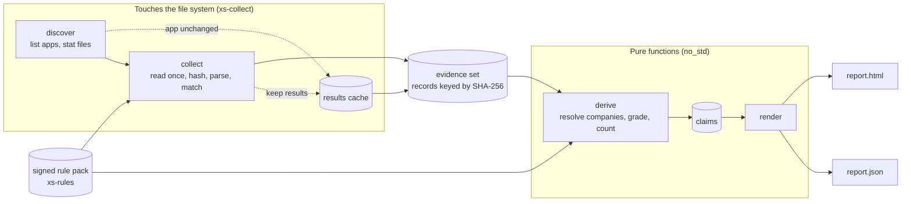
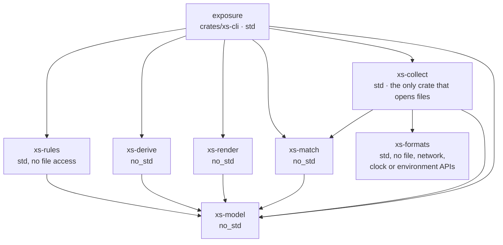

# Architecture

The scanner is a one-way pipeline. Collectors read the disk and emit
evidence; pure functions turn evidence into claims; a renderer turns claims
into a report.

- [Pipeline](#pipeline)
- [Crates](#crates)
- [Reading files](#reading-files)
- [Scheduling](#scheduling)
- [Performance](#performance)
- [How each property is enforced](#how-each-property-is-enforced)
- [Controls against false positives](#controls-against-false-positives)

## Pipeline

Everything left of the evidence set touches the file system. Everything right
of it is a pure function of the evidence and the rule pack, which is what
makes a report reproducible: `exposure report` derives the same report again
from the evidence saved in a JSON file. The results cache sits on the
file-system side: an app that looks as it did when it was read contributes
its kept records instead of being read again, and the report is the same
either way ([details](scanning.md#the-results-cache)).

## Crates

One Cargo workspace. Dependencies only point down the table; an arrow in the
graph reads "depends on".

| Crate | Role | May use |
|---|---|---|
| `xs-model` | Evidence, claim and pack types; canonical JSON; record ids; the fixed list of permissions | `no_std` |
| `xs-formats` | Bounded parsers over byte slices: Mach-O, code signature, property lists, privacy manifests, asar, zip, DEX, binary Android XML, browser extension manifests | std without file, network, clock or environment APIs |
| `xs-match` | Matchers compiled from a pack; hit collection; the controls against false positives | `no_std` |
| `xs-rules` | Pack loader and signature check; the source compiler and lints behind a `compile` feature that only `xtask` enables | std without file access |
| `xs-derive` | Evidence and pack in, claims out: grades, companies, vendors, parties, headline counts | `no_std` |
| `xs-render` | Claims and evidence in, report out: the JSON document and the HTML page | `no_std` |
| `xs-collect` | Discovery, scheduling, reading and the results cache, one module per collector | std |
| `exposure` (`crates/xs-cli`) | The `exposure` binary | std |
| `xtask` | Developer tooling: pack compile and sign, guardrails, no-network checks, benchmark, fixtures. Never shipped | anything |

`fuzz/` holds the fuzz targets. It is a workspace of its own, because it
needs a nightly toolchain and the libFuzzer runtime.

## Reading files

Files are read once, in bounded 1 MiB windows, with the same bytes feeding
the hash and the matcher. A Mach-O file says where to look in it, so its
headers and load commands are picked out of the windows as they go by; the
file is still read exactly once.

An `.apk` file is read once from start to end for its SHA-256. On the way the
manifest and the DEX files are copied out and parsed in memory, one at a
time, so evidence only comes from bytes the hash covers.

Records hold paths inside the artifact only, never a path of the machine.

## Scheduling

The scan has one queue. Every bundle is listed first, which only looks at
names, sizes and times. An app that the cache holds in the state listed is
done with there. Then every file to read, of every other bundle and
package, is one task in one list, largest first. A few files hold most of the bytes
(on the laptop below, half of them sit in 12 files), so the order matters:
they start at once on separate threads, and no thread is left reading a
large file alone at the end. Which thread reads what, and in which order,
cannot reach the report.

## Performance

Measured with `cargo xtask bench` on an Apple M5 (10 cores) over the 16
installed apps, 11,658 files and 6.8 GB read, page cache warm:

| Threads | Time | Speed-up | Peak memory |
|---|---|---|---|
| 1 | 5.96 s | 1.00x | 20 MB |
| 2 | 2.23 s | 2.66x | 25 MB |
| 4 | 1.37 s | 4.32x | 30 MB |
| 8 | 0.91 s | 6.48x | 39 MB |

Those runs keep no cache. With one, and nothing changed since the scan that
filled it, the same scan takes 0.10 s at 8 MB: all 16 apps are found
unchanged and none is read.

All 17 runs gave the same report, byte for byte: 13 without the cache, one
that fills it and three that find it full. The benchmark fails below 3x at
8 threads, at 200 MB of memory, or if the scan with nothing changed takes
5 s. With Rayon's default splitting in place of one task per file it
measures 1.19x and fails. A cold disk was not measured.

Memory does not grow with the bytes read. It grows with the number of files
listed: a bundle of 300,000 small files took 84 MB. And it grows with the
largest entry of a package that is read whole to be parsed, a DEX file or a
manifest: up to the 256 MiB budget, stored and inflated, per worker thread.
DEX files of real apps are a few megabytes.

## How each property is enforced

The scanner reads app lists, so it has to be safer than the apps it reports
on. Each property is enforced by a mechanism and checked in CI rather than
left to discipline.

| Property | How it is enforced | Checked by |
|---|---|---|
| **Private.** A scan opens no socket. | No crate that can open one is allowed into the dependency graph. The lint lists ban the socket, process, clock and environment APIs. | `cargo deny check`; `cargo xtask no-network`: the binary imports no socket function, and the scan runs in a network namespace with no interfaces, under `strace`, and under a macOS sandbox that denies the network, each time without the cache, with an empty one and with a full one. Each check is paired with a control program that must be caught. |
| **Deterministic.** Same evidence, rule pack and scan scope, same bytes. | Derivation and rendering live in `no_std` crates that cannot read a clock, a file or the environment and have no randomly seeded map. Records hold paths inside the artifact only. Evidence is a set keyed by content hash. | One report across input orders, thread counts, install locations and cache states (off, empty, full, damaged); the committed fixture reports must be reproduced byte for byte on Linux and macOS. |
| **Honest.** Every finding shows its grade and the raw record behind it. | The renderers refuse a claim that cites a record the report does not carry. The HTML report carries every record, and each finding links to its own. | A test deletes a cited record and expects the render to fail. Another reads the page back and finds, for every claim, its grade, its confidence and each cited record as stored. |
| **Hostile inputs.** A malicious app cannot crash or mislead the scanner. | Parsers take a byte slice, are written in safe Rust (`unsafe` is forbidden), and stop at budgets of bytes, items and depth. No file over 2 GiB is read for evidence; a binary or archive that large is reported with its size instead. Of a Mach-O file only the headers and at most 1 MiB of load commands per architecture are held in memory, whatever its size. Symbolic links are never followed. The file table of an asar archive is not trusted. Text from files is cut and cleaned before it is stored. | Property tests feed the parsers arbitrary and damaged input. The zip, DEX, Android manifest and browser extension manifest parsers and the Android collector also run under libFuzzer, 60 s each (`fuzz/run.sh`). |
| **Rules are data.** A rule pack cannot run code. | A rule is a literal plus one boundary from a fixed list. The scanner only loads a compiled pack whose signature verifies against a key built into the binary; it contains no parser for rule sources. | A tampered pack is refused; the pack compiler's lints are tested. |
| **Finds what is there, does not cry wolf.** | Several independent witnesses per SDK, with controls against coincidental hits (below). | Each control has its own tests, and a property test checks that cutting a file into windows never changes what is found. Real apps pinned by hash are scanned in CI. |

`cargo xtask guardrails` proves the first two rows from the other side. It
breaks each rule on purpose in a copy of the workspace (uses `std::fs` in a
pure crate, opens a socket, adds an HTTP client as a dependency) and requires
the build to fail for the right reason.

## Controls against false positives

Each control is there because of a failure seen on real apps.

| Control | What it does |
|---|---|
| Scope | Every file is app code, a dependency, a runtime or a resource. Free-form bytes of a runtime, such as an embedded browser engine, are not searched: it holds the names of ad hosts as data. In an Electron app only script files (`.js`, `.cjs`, `.mjs`) are searched, and what sits under a `node_modules` folder is a dependency. Pages, source maps and data files are not searched anywhere: a link in a page names a company without the app talking to it, and libraries ship demo pages and documentation. |
| Boundaries | A token found in free-form bytes must sit on a word or hostname boundary. `i.posthog.com` hits in `us.i.posthog.com` and not in `xi.posthog.com` or `i.posthog.com.evil.example`. |
| Token lints | The pack compiler refuses short content tokens and bare brand domains before a pack is signed. |
| Breadth guard | A file that names eight or more companies is a list, such as an ad blocker's filter list. Its hits are mentions and never findings. The guard counts companies over content-matcher hits only and holds back content-matcher hits only. Table-matcher hits, such as framework names, class tables and manifest entries, say what a file is made of and stay edges. This includes the `dex_string` hits of an Android app whose string table names eight or more companies: they are mentions, and the app's edges come from its class table and manifest. |
| Distinct-token minimum | A rule can demand that several different tokens hit before a kind of witness counts. |
