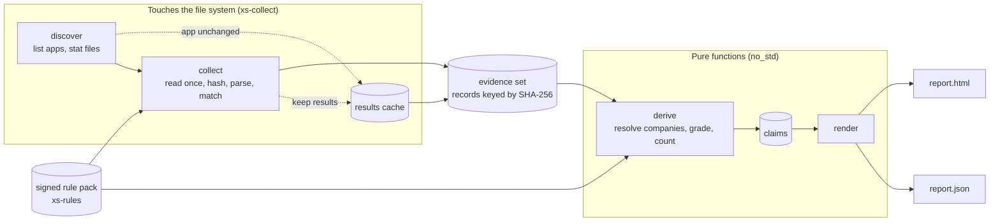
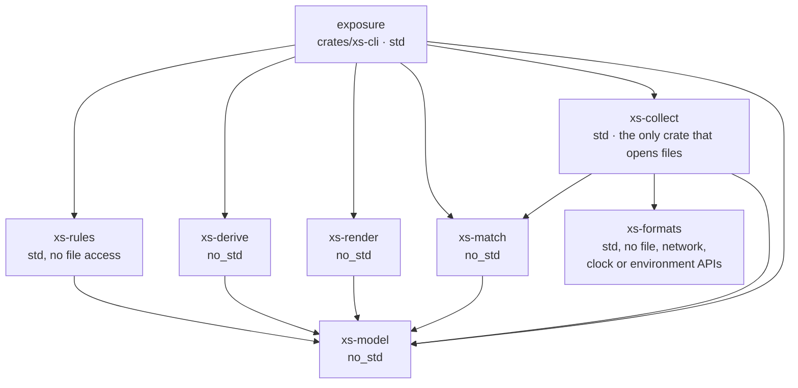

# Architecture

The scanner is a one-way pipeline. Collectors read the disk and emit
evidence; pure functions turn evidence into claims; a renderer turns claims
into a report.

- [Pipeline](#pipeline)
- [Crates](#crates)
- [Reading files](#reading-files)
- [Scheduling](#scheduling)
- [Performance](#performance)
- [How each property is enforced](#how-each-property-is-enforced)
- [Controls against false positives](#controls-against-false-positives)

## Pipeline

Everything left of the evidence set touches the file system. Everything right
of it is a pure function of the evidence and the rule pack, which is what
makes a report reproducible: `exposure report` derives the same report again
from the evidence saved in a JSON file. The results cache sits on the
file-system side: an app that looks as it did when it was read contributes
its kept records instead of being read again, and the report is the same
either way ([details](scanning.md#the-results-cache)).

## Crates

One Cargo workspace. Dependencies only point down the table; an arrow in the
graph reads "depends on".

| Crate | Role | May use |
|---|---|---|
| `xs-model` | Evidence, claim and pack types; canonical JSON; record ids; the fixed list of permissions | `no_std` |
| `xs-formats` | Bounded parsers over byte slices: Mach-O, code signature, property lists, privacy manifests, asar, zip, DEX, binary Android XML, the Android resource table, an app bundle's protocol buffers, browser extension manifests | std without file, network, clock or environment APIs |
| `xs-match` | Matchers compiled from a pack; hit collection; the controls against false positives | `no_std` |
| `xs-rules` | Pack loader and signature check; the source compiler and lints behind a `compile` feature that only `xtask` enables | std without file access |
| `xs-derive` | Evidence and pack in, claims out: grades, companies, vendors, parties, headline counts | `no_std` |
| `xs-render` | Claims and evidence in, report out: the JSON document and the HTML page | `no_std` |
| `xs-collect` | Discovery, scheduling, reading and the results cache, one module per collector | std |
| `exposure` (`crates/xs-cli`) | The `exposure` binary | std |
| `xtask` | Developer tooling: pack compile and sign, guardrails, no-network checks, benchmark, differential test, fixtures. Never shipped | anything |

`fuzz/` holds the fuzz targets. It is a workspace of its own, because it
needs a nightly toolchain and the libFuzzer runtime.

## Reading files

Files are read once, in bounded 1 MiB windows, with the same bytes feeding
the hash and the matcher. A Mach-O file says where to look in it, so its
headers and load commands are picked out of the windows as they go by; the
file is still read exactly once. A file is told apart by its first 16 bytes,
read on their own, so a file that is not one the collector reads costs one
small read; a script, which is read whatever its first bytes, is read a
window at a time from its first byte. The size the listing saw decides
whether a file is asked for its size again before it is read: only one
listed over the byte budget is. One that grew past the budget since it was
listed is stopped one byte past it, like any file.

An `.apk` or `.aab` file is read once from start to end for its SHA-256. On
the way the manifest, the resource table and the DEX files are copied out
and parsed in memory, so evidence only comes from bytes the hash covers. The
DEX files are let go one at a time. The resource table is only read for
the one string the manifest says is the app's name: a table that comes after
the manifest in the archive, as it does in packages that build tools write,
is looked up as it is read and let go; one that comes before it is kept
until the manifest has been read. A deflated DEX file
is first inflated to its 112-byte header. If the header alone decides what
the file holds, because the file is refused for it or holds no string and
defines no class, the rest of the stream is only checked, to its end and in
a 96 KiB window, for whether it inflates to what the entry declares: the
outcome is the one inflating it whole gives, without the memory. Every real
DEX file needs its content, and is inflated whole as before.

Records hold paths inside the artifact only, never a path of the machine.

## Scheduling

The scan has one queue. Every bundle is listed first, which only looks at
names, sizes and times. An app that the cache holds in the state listed is
done with there. Then every file to read, of every other bundle and
package, is one task. A few files hold most of the bytes (on the laptop
below, half of them sit in 12 files), so the order matters: files of
256 KiB or more are started largest first, each by the next worker to be
free, which takes it from a counter all of them share, so they start at
once on separate threads and no thread is left reading a large file alone
at the end. Rayon's splitting, which the queue used before, deals a list out
by halves even with one item per task: the files just behind the largest
waited on the first thread's own queue.

A small file costs system calls, not bytes, and on macOS those do not scale
with threads. Reading a folder of 102,161 files, all but 80 of them small,
on the Apple M5 below took 1.1 s with 3 or 4 threads and 2.2 to 2.5 s with
10, which spent 16 to 18 s in the kernel against 3 to 4.6 s; the 22,728
files under 64 KB of its `/Applications` alone, 0.14 s with 4 and 0.29 s
with 10. So files under 256 KiB are a second lane, in
the order of the list, which keeps a folder's files together, on at most 4
threads at once on macOS; listing the bundles, which is all system calls,
runs on at most 4 as well. Some workers start on the small lane and the
others on the large one, and a worker whose lane runs dry moves to the
other, so the system calls of the small files overlap the reading of the
large ones instead of following it. Elsewhere no such limit was measured,
and every worker may take small files. Which thread reads what, and in
which order, cannot reach the report.

## Performance

Measured with `cargo xtask bench --strict` on an Apple M5 (4 performance
and 6 efficiency cores) over the 16 installed apps and 8 browser
extensions, 10,760 files and 6.85 GB read, against the build before the
current reader, queue and engine (`main` at db8c460, 2026-11-22):

| Threads | Before | Now | Speed-up now | Peak memory now |
|---|---|---|---|---|
| 1 | 9.04 s | 7.32 s | 1.00x | 27 MB |
| 2 | 3.58 s | 2.96 s | 2.46x | 26 MB |
| 4 | 2.23 s | 2.28 s | 3.21x | 32 MB |
| 8 | 1.96 s | 1.63 s | 4.48x | 40 MB |

Each figure is the fastest of three runs; the two builds were measured one
after the other on a machine in use, and runs of the two taken in turn, in
the same conditions, gave a median of 1.16 s against 1.60 s for the 14 apps
of `/Applications` without the cache. The first scan, which fills an empty
cache, took 1.63 s against 2.10 s.
Those runs keep no cache. With one, and nothing changed since the scan that
filled it, the same scan takes 0.11 s at 9 MB: all 16 apps are found
unchanged and none is read. That is all listing, one bundle at a time: the
largest app there, with 13,443 files in 3,251 folders, takes 0.07 s of it.

The page cache of that laptop, in use, does not hold the 8.5 GB of its
`/Applications`, so part of every run reads the disk. Reading the 149 files
of over 4 MB alone, with nothing else done, tops out at 7.7 GB/s from two to
four threads (0.96 s for 7.4 GB): the floor of any scan that has to hash
every byte it reports on, which this one does, since a bundle's digest
covers them all. On one thread, hashing (SHA-256 at about 3.9 GB/s on a
performance core) and the search take most of what is left; the search was
the largest single cost before it was built as a DFA.

All 17 runs gave the same report, byte for byte: 13 without the cache, one
that fills it and three that find it full. The benchmark fails below 3x at
8 threads, at 200 MB of memory, or if the scan with nothing changed takes
5 s. With Rayon's default splitting in place of one task per file it
measures 1.19x and fails. A cold disk was not measured.

`cargo xtask difftest` checks that none of this changes a report: it builds
`origin/main` (or any commit) beside the working tree and scans the
committed fixtures, a corpus it writes from the rule pack, and any folder
given, such as `/Applications`, with both, without the cache, on one thread
and with the cache empty and full. CI runs it on every change against the
commit the change goes onto.

Memory does not grow with the bytes read. It grows with the number of files
listed: a bundle of 300,000 small files took 84 MB. And it grows with the
largest entry of a package that is read whole to be parsed, a DEX file or a
manifest, but not with the number of packages. Each worker thread keeps
three buffers that it reads every entry into, the stored bytes, the
inflated bytes and a resource table that comes before its manifest, and
never frees: up to 32 MiB each (the table up to its 64 MiB budget), which
is room for the DEX files of real apps, a few megabytes each. An entry
larger than that, up to the 256 MiB budget, takes one of four buffers the
whole scan shares, and a thread waits while all four are in use: 1 GiB at
most, whatever the number of threads. On a folder of 24 crafted packages,
each 1 MB holding four DEX files that inflate to 255 MiB, a scan peaks at
272 MB at one thread and at 1.1 GB at ten. The same packages with DEX files
of zeros, which a scan refuses for their header after checking their
streams in a window, peak at 6 MB and 23 MB; before that they cost as much
as the others. 30 real packages (2.5 GB) take 27 MB at one thread and
228 MB at ten. Before these buffers, every entry had allocations of its
own, and macOS's allocator, which keeps large freed blocks for the process,
took the crafted folder to 15.7 GB at one thread. `cargo xtask bench` gates
the crafted folder at 600 MB at one thread and 1.5 GB at one per core, and
the one of zeros at 150 MB at one per core.

## How each property is enforced

The scanner reads app lists, so it has to be safer than the apps it reports
on. Each property is enforced by a mechanism and checked in CI rather than
left to discipline.

| Property | How it is enforced | Checked by |
|---|---|---|
| **Private.** A scan opens no socket. | No crate that can open one is allowed into the dependency graph. The lint lists ban the socket, process, clock and environment APIs; the one exception, handing the finished report to the system's opener, is described in the [threat model](threat-model.md#the-one-process-the-scanner-starts). | `cargo deny check`; `cargo xtask no-network`: the binary imports no socket function, and the scan runs in a network namespace with no interfaces, under `strace`, and under a macOS sandbox that denies the network, each time without the cache, with an empty one and with a full one. Each check is paired with a control program that must be caught. |
| **Deterministic.** Same evidence, rule pack and scan scope, same bytes. | Derivation and rendering live in `no_std` crates that cannot read a clock, a file or the environment and have no randomly seeded map. Records hold paths inside the artifact only. Evidence is a set keyed by content hash. | One report across input orders, thread counts, install locations and cache states (off, empty, full, damaged); the committed fixture reports must be reproduced byte for byte on Linux and macOS; `cargo xtask difftest`: the build of a change gives the reports of the commit it goes onto, on the fixtures, a corpus made from the pack and the pinned real and negative-control apps. |
| **Honest.** Every finding shows its grade and the raw record behind it. | The renderers refuse a claim that cites a record the report does not carry. The HTML report carries every record, and each finding links to its own. | A test deletes a cited record and expects the render to fail. Another reads the page back and finds, for every claim, its grade, its confidence and each cited record as stored. |
| **Hostile inputs.** A malicious app cannot crash or mislead the scanner. | Parsers take a byte slice, are written in safe Rust (`unsafe` is forbidden), and stop at budgets of bytes, items and depth. No file over 2 GiB is read for evidence; a binary or archive that large is reported with its size instead. Of a Mach-O file only the headers and at most 1 MiB of load commands per architecture are held in memory, whatever its size. Symbolic links are never followed. The file table of an asar archive is not trusted. Text from files is cut and cleaned before it is stored. | Property tests feed the parsers arbitrary and damaged input. The parsers and the Android collector also run under libFuzzer, 60 s each (`fuzz/run.sh`); the [threat model](threat-model.md#a-hostile-app-cannot-take-over-the-scan) lists what is fuzzed. |
| **Rules are data.** A rule pack cannot run code. | A rule is a literal plus one boundary from a fixed list. The scanner only loads a compiled pack whose signature verifies against a key built into the binary; it contains no parser for rule sources. | A tampered pack is refused; the pack compiler's lints are tested. |
| **Finds what is there, does not cry wolf.** | Several independent witnesses per SDK, with controls against coincidental hits (below). | Each control has its own tests, and a property test checks that cutting a file into windows never changes what is found. The canary test plants every token of every rule in synthetic apps and requires 95% of them found (all are). A corpus of real apps pinned by hash, with hard negatives such as a browser and an ad blocker, must show no channel to another company: a subset on every change, all of it nightly. |
| **Reproducible.** Two clean builds of one commit give the same binary. | Workspace files are named relative to the workspace; the release build strips debug information, and on macOS the linker is told to write no debug map, whose paths would otherwise reach the binary's UUID (`crates/xs-cli/build.rs`). | `cargo xtask repro` builds a commit twice from copies at different paths and compares the binaries, nightly on macOS and Linux. |

`cargo xtask guardrails` proves the first two rows from the other side. It
breaks each rule on purpose in a copy of the workspace (uses `std::fs` in a
pure crate, opens a socket, adds an HTTP client as a dependency) and requires
the build to fail for the right reason.

## Controls against false positives

Each control is there because of a failure seen on real apps.

| Control | What it does |
|---|---|
| Scope | Every file is app code, a dependency, a runtime or a resource. Free-form bytes of a runtime, such as an embedded browser engine, are not searched: it holds the names of ad hosts as data. In an Electron app only script files (`.js`, `.cjs`, `.mjs`) are searched, and what sits under a `node_modules` folder is a dependency. Pages, source maps and data files are not searched anywhere: a link in a page names a company without the app talking to it, and libraries ship demo pages and documentation. |
| Boundaries | A token found in free-form bytes must sit on a word or hostname boundary. `i.posthog.com` hits in `us.i.posthog.com` and not in `xi.posthog.com` or `i.posthog.com.evil.example`. |
| Token lints | The pack compiler refuses short content tokens and bare brand domains before a pack is signed. |
| Breadth guard | A file that names eight or more companies is a list, such as an ad blocker's filter list. Its hits are mentions and never findings. The guard counts companies over content-matcher hits only and holds back content-matcher hits only. Table-matcher hits, such as framework names, class tables and manifest entries, say what a file is made of and stay edges. This includes the `dex_string` hits of an Android app whose string table names eight or more companies: they are mentions, and the app's edges come from its class table and manifest. |
| Distinct-token minimum | A rule can demand that several different tokens hit before a kind of witness counts. |
